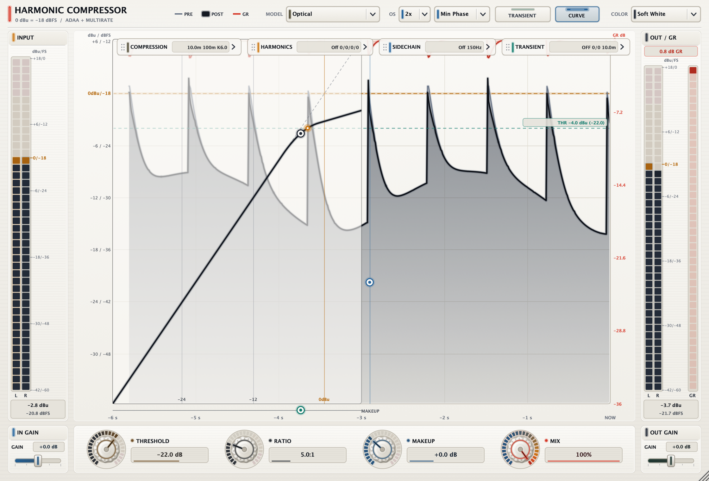
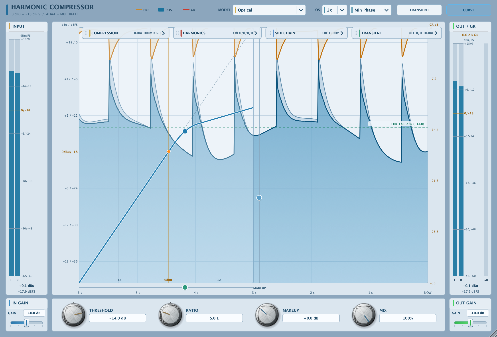
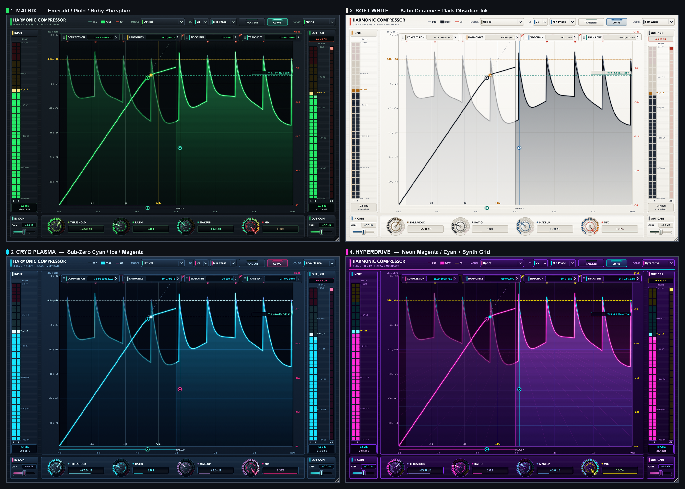
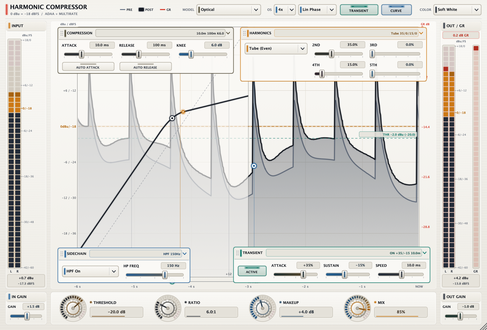
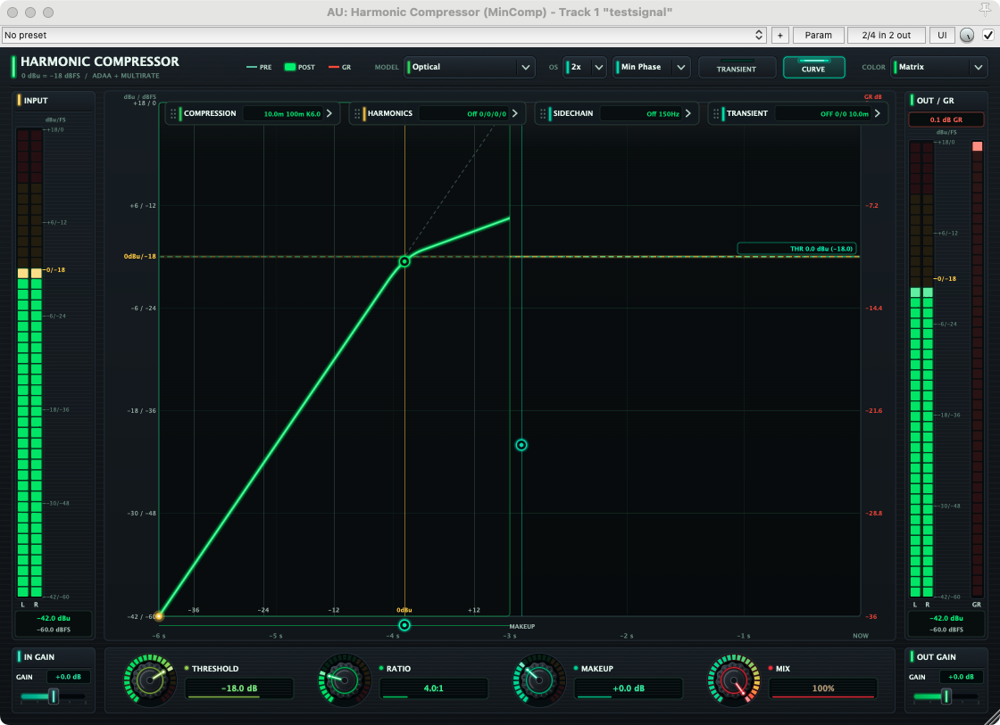

# Harmonic Compressor (version 1.5.0)

Harmonic Compressor is a mastering-grade, multi-topology analogue dynamics processor and harmonic saturation engine. Built with physical-circuit component modeling and first-order Antiderivative Anti-Aliasing (ADAA), it combines seven distinct analogue compression topologies, an integrated transient designer, a multi-order harmonic saturation stage, and an interactive real-time transfer curve display.

## Architecture & Signal Flow

Harmonic Compressor implements a pristine, zero-latency direct signal path designed for both individual tracks and master bus processing.

1. **Input Conditioning & Transient Shaper:** The incoming audio passes through an adjustable input gain stage into a dedicated transient designer. The transient designer can emphasize or soften initial attack spikes and boost or attenuate sustain tails before or alongside dynamic gain reduction.
2. **Sidechain & Analogue Model Detection:** A continuous level detector evaluates signal power using the selected compression topology. Depending on the model, detection operates in RMS, peak, or optical photodiode modes with feed-forward or feedback routing.
3. **Multi-Topology Gain Computer:** The selected model computes the non-linear gain reduction curve with soft-knee transition, program-dependent envelope ballistics, and optional punch relief.
4. **ADAA Harmonic Waveshaper:** The post-compression signal enters a zero-delay 1st-order ADAA saturation stage capable of generating 2nd, 3rd, 4th, and 5th harmonic content without in-band aliasing. A sub-audio 3.5 Hz DC blocker transparently strips bias offsets generated by asymmetric even-harmonic drive.
5. **Output Makeup, Dry/Wet Blend & Smooth Rail Limiter:** Output gain and parallel dry/wet mixing allow instantaneous New York-style parallel compression, protected by an ADAA-linearised smooth rail ceiling limiter.

## The Seven Analogue Topologies

Harmonic Compressor features seven meticulously modeled compressor engines, covering the most iconic dynamics circuits in recording history:

- **Red:** Discrete Class-A VCA console channel compressor inspired by classic British high-end broadcast desks. Features a progressive soft knee and reactive punch relief that preserves punchy drum transients while heavily flattening sustained decay.
- **Hybrid:** A state-of-the-art modern topology blending feed-forward speed with smooth feedback release envelope ballistics. Ideal for complex full mixes and stems where transparency and precise control are demanded.
- **Bridge:** Classic German diode-bridge feedback compressor. Characterized by a distinctive non-linear transfer knee, organic harmonic thickness, and smooth, musical density across percussion and acoustic instruments.
- **Bus VCA:** The legendary British console master bus compressor. Delivers signature "glue" and punch across drum busses and full stereo master mixes with auto-release timing and logarithmic release decay.
- **76:** Ultra-fast discrete Field Effect Transistor (FET) peak limiter. Delivers lightning attack speeds down to 20 microseconds and a program-dependent dual-time-constant release that adds aggression, excitement, and presence to vocals, snares, and bass.
- **Opto Leveler:** Electro-luminescent optical attenuator circuit modeled after the classic T4B opto-cell. Features a smooth, two-stage memory-dependent release curve where initial gain recovery is swift while deep compression decays slowly, yielding transparent, effortless vocal and bass leveling.
- **VCA 160:** Legendary feed-forward VCA compressor with RMS level detection and a punchy hard knee. World-renowned for its snappy attack on kicks, snares, slap bass, and percussive synths.

| Model | Detector Type | Circuit Topology | Attack Range | Release Range | Best Suited For |
|---|---|---|---|---|---|
| **Red** | Peak / Soft VCA | Feed-Forward | 0.5 ms – 100 ms | 20 ms – 2.5 s | Drums, acoustic guitars, punchy mix elements |
| **Hybrid** | Peak / True RMS | Dual FF / FB | 0.1 ms – 120 ms | 10 ms – 3.0 s | Mix bus, master channel, vocal stems |
| **Bridge** | Diode Ring | Feedback | 1.0 ms – 80 ms | 30 ms – 1.8 s | Retro drums, room mics, electric guitars |
| **Bus VCA** | RMS VCA | Feedback | 0.2 ms – 60 ms | 50 ms – 2.0 s (Auto) | Stereo drum bus, mix glue, submixes |
| **76** | Fast FET | Feedback | 0.02 ms – 1.0 ms | 50 ms – 1.1 s | Vocals, snare smack, parallel smash |
| **Opto Leveler**| Optical T4B | Feedback (Opto) | 10 ms fixed | Dual 60 ms / 5.0 s | Lead vocals, bass, strings, smooth leveling |
| **VCA 160** | RMS Hard VCA | Feed-Forward | 1.0 ms – 50 ms | 20 ms – 1.5 s | Kick, snare, slap bass, acoustic percussion |

<!-- pagebreak -->

## ADAA Harmonic Saturation Engine

Harmonic saturation in the digital domain typically causes severe high-frequency mirror aliasing that impairs clarity and adds harshness. Harmonic Compressor overcomes this using continuous first-order Antiderivative Anti-Aliasing (ADAA) combined with optional 4x linear-phase oversampling.

The continuous waveshaping polynomial evaluates analytical antiderivatives across sample steps:

$$\bar{y}[n] = \frac{F_1(x[n]) - F_1(x[n-1])}{x[n] - x[n-1]}$$

When adjacent samples approach each other ($|x[n] - x[n-1]| < 10^{-5}$), the engine switches to a high-order Taylor expansion to guarantee numerical stability.

- **Tube (Even Order):** Emphasizes 2nd and 4th order harmonics, imparting three-dimensional warmth, physical depth, and body to thin recordings. An integrated sub-audio 3.5 Hz DC blocker cancels asymmetrical voltage drift without degrading sub-bass frequency response.
- **Tape (Odd Order):** Emphasizes 3rd and 5th order odd harmonics, producing tape-style compression, high-frequency rounding, and punchy saturation.
- **Smooth Rail Limiter:** Secondary ADAA-buffered soft-clipping ceiling ensures no hard digital overshoots pass through to your DAW converters.

## Transient Designer & Sidechain Relief

Harmonic Compressor integrates an analogue transient processor into the detection and audio path:

- **Attack Emphasis (+/- 12 dB):** Boosts the front-end impact of percussive hits before the compressor reacts, allowing punch to punch through dense walls of sound.
- **Sustain Tail (+/- 12 dB):** Amplifies natural room reverberation, cymbal decay, and bass ring, or attenuates loose low-frequency mud before compression.
- **Sidechain High-Pass Filter (Off to 350 Hz):** Prevents heavy bass and kick transients from excessively triggering pumping artifacts on stereo busses.

## Dynamic Auto-Scaling Metering & Real-Time Transfer Curve

The central visualization display combines an interactive compression transfer curve and auto-scaling peak/VU/GR meters:

- **Real-Time Transfer Curve:** Graphically renders the active threshold, ratio slope, and knee curvature. Live input and output audio levels are traced across the transfer line in real time.
- **Auto-Scale GR Metering:** When working with subtle bus compression (-1 dB to -3 dB) or extreme limiting (-20 dB), the meter display dynamically scales to provide high-resolution visual feedback.
- **Side-by-Side In/Out Peak & RMS Bars:** Precision PPM-style level meters with integrated clip indicators let you match gain staging and evaluate perceptual loudness effortlessly.

<!-- pagebreak -->

## Interface Customization & Themes

Harmonic Compressor features four distinct UI themes crafted for long studio sessions and different ambient lighting conditions:

- **Soft White:** Clean, low-fatigue minimalist aesthetic with high-contrast dark transfer display and brushed controls.
- **Matrix Phosphor:** Retro CRT green glow reminiscent of vintage lab oscilloscopes and hardware spectrum analyzers.
- **Cryo Plasma:** Futuristic deep-space cobalt and cyan neon accents designed for high-resolution dark environments.
- **Hyperdrive Amber:** Warm vacuum-tube amber and brass indicators providing a tactile vintage hardware feel.

### Floating Modular Windows

Each sub-panel (Transient Designer, ADAA Harmonic Engine, Metering Options) can be detached into an independent floating module window. This allows dual-monitor workflows, multi-channel side-by-side comparison, or ultra-compact plugin arrangements inside your DAW.

## DAW Host Integration & Performance

Harmonic Compressor is tested and certified across all major professional digital audio workstations including Apple Logic Pro, Avid Pro Tools, Cockos REAPER, Ableton Live, Steinberg Cubase, and Studio One.

- **True Zero Latency:** In standard 1x mode, processing latency is exactly 0 samples (0 ms), making it suitable for live tracking and low-latency monitoring.
- **Optimized DSP:** Highly vectorized SIMD architecture consumes under 1.0% CPU per stereo instance on Apple Silicon and modern x86_64 processors.
- **Parameter Automation:** Every knob, toggle switch, and mode selector is fully exposed for sample-accurate parameter automation in all host environments.

<!-- pagebreak -->

## Parameter Reference

| Parameter ID | Parameter Name | Range | Default | Unit | Description |
|---|---|---|---|---|---|
| `threshold` | Threshold | -60.0 to 0.0 | -18.0 | dB | Level above which compression is initiated |
| `ratio` | Ratio | 1.0:1 to 20.0:1 | 4.0:1 | :1 | Compression ratio above threshold |
| `attack` | Attack Time | 0.02 to 120.0 | 10.0 | ms | Time required for gain reduction to reach target |
| `release` | Release Time | 10.0 to 3000.0 | 120.0 | ms | Time required for gain recovery after signal drops |
| `knee` | Knee Width | 0.0 to 18.0 | 3.0 | dB | Softness of the transition curve into compression |
| `model` | Compressor Model | 7 Topologies | Red | enum | Active circuit modeling algorithm |
| `makeup` | Makeup Gain | -12.0 to +24.0 | 0.0 | dB | Output gain applied to the compressed signal |
| `mix` | Dry / Wet Mix | 0.0 to 100.0 | 100.0 | % | Parallel compression balance |
| `harmonics_drive`| Saturation Drive | 0.0 to 100.0 | 0.0 | % | Drive level into the ADAA harmonic waveshaper |
| `harmonics_type` | Saturation Flavor | Clean, Tube, Tape | Tube | enum | Harmonic character: Clean, Even (Tube), Odd (Tape)|
| `transient_attack`| Transient Attack | -12.0 to +12.0 | 0.0 | dB | Front-end transient punch emphasis or cut |
| `transient_sustain`| Transient Sustain| -12.0 to +12.0 | 0.0 | dB | Sustain tail amplification or attenuation |
| `sc_hpf` | Sidechain HPF | Off, 20 to 350 | Off | Hz | Sidechain high-pass filter cutoff frequency |
| `oversampling` | Oversampling | 1x, 2x, 4x | 1x | enum | Resampling factor for alias-free processing |
| `theme` | Interface Theme | 4 Styles | Soft White | enum | UI color theme and visual palette |

## System Requirements & Formats

- **macOS:** macOS 11.0 Big Sur or later (Native Apple Silicon arm64 and Intel x86_64 Universal Binary).
- **Supported Formats:**
  - **VST3:** 64-bit compatible host (DAW).
  - **Audio Units (AU):** 64-bit AUv2 host.
  - **AAX Native:** Pro Tools 2022+ (PACE Eden Signed).
  - **CLAP:** CLAP 1.2+ host.
  - **LV2:** LV2 compatible host.
  - **Standalone:** Native standalone application with CoreAudio support.
- **RAM:** 4 GB minimum (8 GB recommended).
- **Display:** 1280 x 800 minimum screen resolution (Retina / 4K Ultra-HD supported).
