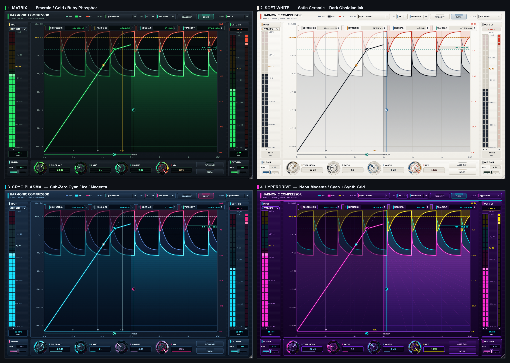
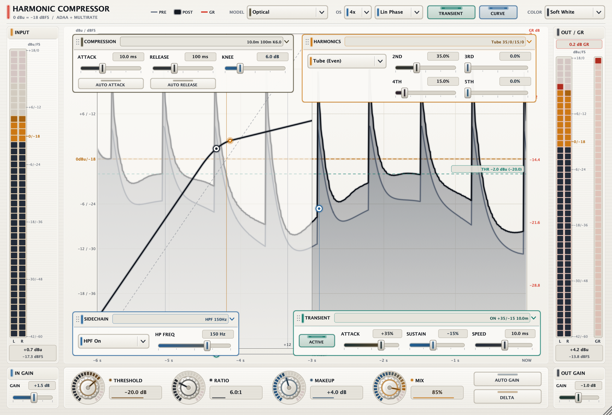
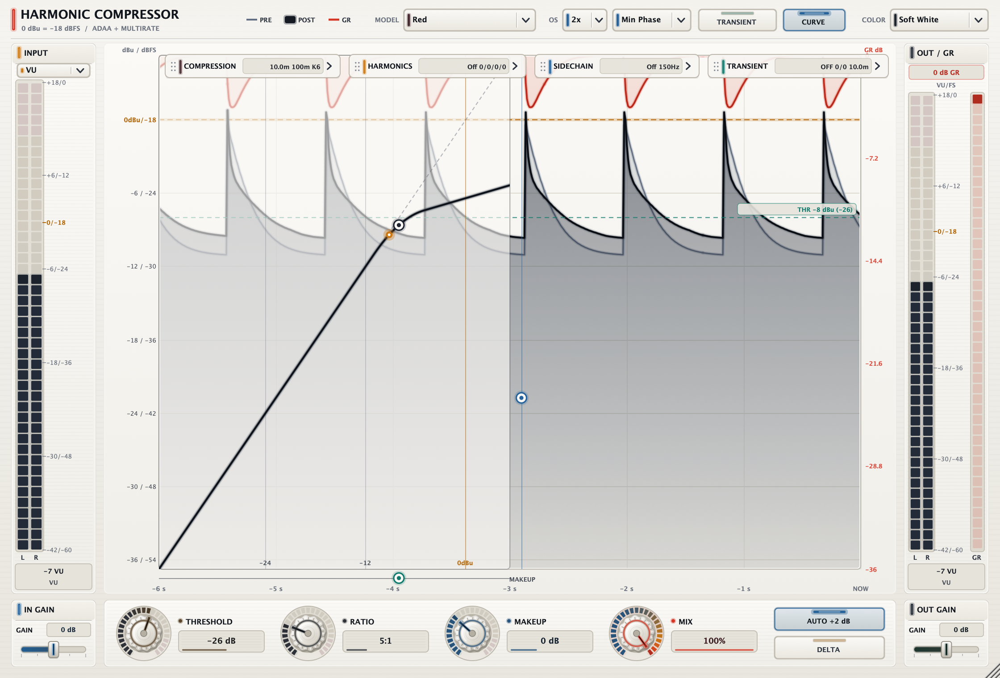

# Harmonic Compressor

[](VERSION)
[](LICENSE)
[]()
[-lightgrey.svg)]()

Harmonic Compressor is a mastering-grade analogue dynamics processor and harmonic saturation plugin, written in Rust on [OpenPluginSDK](https://github.com/MistaMin/OpenPluginSDK). It combines seven meticulously modeled analogue compression circuits, continuous first-order Antiderivative Anti-Aliasing (ADAA) harmonic coloration, an integrated transient designer, PPM, RMS and VU meters, and an interactive real-time compression transfer curve display.


| Themes | Movable modules | Auto Gain on, live metering |
|---|---|---|
|  |  |  |

## Version 1.6.0

- **Rebuilt in Rust on OpenPluginSDK.** Same sound at 1x, same controls and look; sessions, presets and automation of 1.5.x load.
- **Meters:** PPM in dBFS (IEC 60268-10 Type I, the default), RMS in dBFS or VU (0 VU = -18 dBFS), chosen on the input meter and saved with the session. Readouts are whole numbers.
- **Whole steps:** Threshold, Ratio, Knee, Makeup, the gains, the harmonics and the transient amounts move in whole dB, ratios and percent.
- **External sidechain in every format,** including the Audio Unit's second input and the AAX key input.
- **Oversampling** uses new anti-alias filters; 2x, 4x and 8x sound slightly different from 1.5.3.
- The editor uses no CPU while nothing moves, and screen readers get every control's name and value.

## Download

- **macOS (11 or later, Apple silicon and Intel):** [Harmonic-Compressor-1.6.0-macos.pkg](https://github.com/MistaMin/HarmonicCompressor/releases/download/v1.6.0/Harmonic-Compressor-1.6.0-macos.pkg) ([SHA-256](https://github.com/MistaMin/HarmonicCompressor/releases/download/v1.6.0/Harmonic-Compressor-1.6.0-macos.pkg.sha256)). The installer puts VST3, AU, CLAP, LV2 and AAX in the standard plug-in folders and the manual and licences in `/Library/Application Support/Harmonic Compressor`. It is signed with a Developer ID and notarized by Apple; the AAX is PACE-signed for Pro Tools.
- **User manual:** [HarmonicCompressor-1.6.0-User-Manual.pdf](https://github.com/MistaMin/HarmonicCompressor/releases/download/v1.6.0/HarmonicCompressor-1.6.0-User-Manual.pdf)
- All releases: [GitHub Releases](https://github.com/MistaMin/HarmonicCompressor/releases). Also available through the OpenGrid Plugin Manager.
- Not available yet: Windows and Linux builds, a Standalone app, and an AudioSuite version of the AAX. Tested hosts for 1.6.0: REAPER (VST3, AU, CLAP, LV2, each with an external sidechain); Pro Tools, Logic and Studio One were not tested with this version.

## Highlights & Features

- **7 Analogue Modeled Topologies:**
  - **Red:** Discrete Class-A VCA console channel dynamics with reactive punch relief.
  - **Hybrid:** Dual feed-forward/feedback topology for mix bus and master stems.
  - **Bridge:** Classic German diode-bridge feedback circuit with rich harmonic density.
  - **Bus VCA:** British console stereo master bus compressor with logarithmic release decay.
  - **76:** Ultra-fast FET peak limiter with lightning attack and dual-time-constant release.
  - **Opto Leveler:** Dual electro-luminescent photocell T4B optical leveling attenuator.
  - **VCA 160:** Aggressive RMS-detecting feed-forward VCA with signature punchy snap.
- **Continuous 1st-Order ADAA Saturation:**
  - High-order polynomial waveshaping linearised through exact antiderivatives.
  - Even harmonics (Tube warmth: $H_2, H_4$) with sub-audio 3.5 Hz DC blocker.
  - Odd harmonics (Tape saturation: $H_3, H_5$) and secondary smooth rail ceiling limiter.
- **Built-in Transient Designer:**
  - Independent Attack and Sustain controls (-100% to +100%) with 0.5-50 ms detector speed, after the dry/wet mix and before output trim.
  - Sidechain High-Pass Filter (20 to 500 Hz, with bypass and audition modes).
- **Auto Gain & Delta:**
  - Auto Gain matches the output to the input's K-weighted short-term loudness (BS.1770 / EBU R128), so processing is judged without a level change.
  - Delta plays only what the plugin changes (output minus the delay-compensated dry signal).
- **Visual Ergonomics & 4 Themes:**
  - **Soft White:** Minimalist high-contrast studio chassis.
  - **Matrix Phosphor:** Retro CRT green glow.
  - **Cryo Plasma:** Deep cobalt & cyan neon accents.
  - **Hyperdrive:** Ultraviolet, magenta and cyan synthwave palette.
  - Movable, collapsible modules inside the plugin window.
- **Meters:** PPM, RMS or VU on input and output, with whole-number readouts and an auto-scaling gain-reduction display.
- **Zero Latency:** Native 0 samples latency at 1x oversampling, ideal for tracking.
- **Multi-Format:** Ships as **VST3, AU, AAX Native (PACE Eden Signed), CLAP and LV2** (Universal Apple Silicon arm64 & Intel x86_64). No Standalone app is shipped.

## Building from Source

The plugin is the Rust crate in [`plugin/`](plugin). It needs a Rust toolchain, CMake and a checkout of [OpenPluginSDK](https://github.com/MistaMin/OpenPluginSDK); the VST3, Audio Unit and AAX formats also need those SDKs (the AAX SDK is not public and is optional).

```bash
git clone https://github.com/MistaMin/HarmonicCompressor.git
git clone https://github.com/MistaMin/OpenPluginSDK.git
cd HarmonicCompressor

OPENPLUGIN_SDK="$PWD/../OpenPluginSDK" . Scripts/sdk_env.sh   # points cargo at the SDK checkout
(cd plugin && cargo test --release)                           # unit tests, conformance kit, host behaviour

VST3_SDK=/path/to/vst3sdk AU_SDK=/path/to/AudioUnitSDK AAX_SDK=/path/to/aax-sdk-2-8-1 \
  "$SDK_DIR/scripts/build_plugin.sh" --manifest-path plugin/Cargo.toml \
  --name "Harmonic Compressor" --bundle-id com.opengrid.harmoniccompressor --manufacturer OpenGrid \
  --editor --tail --aax-pages --ttl-bin lv2_ttl --formats clap,lv2,vst3,au,aax --archs universal \
  --out dist
```

Leave a format out of `--formats` when you do not have its SDK. The SDK revision of each release build is recorded in its QA folder (1.6.0: [`qa/2026-11-27-release-1.6.0/`](qa/2026-11-27-release-1.6.0)). The editor is macOS only for now.

`Source/` and `CMakeLists.txt` are the JUCE version, 1.5.3. They are kept as the reference the port was checked against (`qa/2026-11-26-rust-port/`) and are no longer what the release is built from.

See the [release notes](RELEASE_NOTES.md) for every version.

To compile the versioned PDF user manual:
```bash
python3 tools/build_user_manual.py
```

## Documentation

A color user manual with model descriptions, signal flow and all 27 host parameters is available in [`Docs/UserManual.md`](Docs/UserManual.md) and compiles to `output/pdf/HarmonicCompressor-User-Manual.pdf`.

## Licensing & Compliance

- **Plugin Code:** Open-source under the [MIT License](LICENSE), copyright Marcos Quirino Deida.
- **Official binaries:** freeware under [LICENSE-BINARIES.txt](LICENSE-BINARIES.txt); third-party notices in [THIRD_PARTY_LICENSES.md](THIRD_PARTY_LICENSES.md).
- **Framework:** Built on [OpenPluginSDK](https://github.com/MistaMin/OpenPluginSDK) (MIT or Apache-2.0) and the format SDKs listed in [THIRD_PARTY_LICENSES.md](THIRD_PARTY_LICENSES.md).
- **Trademarks:** AAX and Pro Tools are trademarks of Avid Technology, Inc. VST is a registered trademark of Steinberg Media Technologies GmbH. Audio Units, Logic and macOS are trademarks of Apple Inc.
