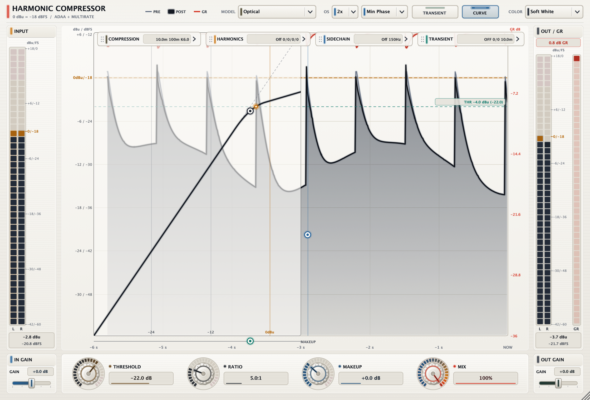

# Harmonic Compressor

[](VERSION)
[](LICENSE)
[]()
[-lightgrey.svg)]()

Harmonic Compressor is a mastering-grade analogue dynamics processor and harmonic saturation plugin built with JUCE. Combining seven meticulously modeled analogue compression circuits, continuous first-order Antiderivative Anti-Aliasing (ADAA) harmonic coloration, an integrated transient designer, auto-scaling meters, and an interactive real-time compression transfer curve display.



## Highlights & Features

- **7 Analogue Modeled Topologies:**
  - **Red:** Discrete Class-A VCA console channel dynamics with reactive punch relief.
  - **Hybrid:** Dual feed-forward/feedback topology for mix bus and master stems.
  - **Bridge:** Classic German diode-bridge feedback circuit with rich harmonic density.
  - **Bus VCA:** British console stereo master bus compressor with logarithmic release decay.
  - **76:** Ultra-fast FET peak limiter with lightning attack and dual-time-constant release.
  - **Opto Leveler:** Dual electro-luminescent photocell T4B optical leveling attenuator.
  - **VCA 160:** Aggressive RMS-detecting feed-forward VCA with signature punchy snap.
- **Continuous 1st-Order ADAA Saturation:**
  - High-order polynomial waveshaping linearised through exact antiderivatives.
  - Even harmonics (Tube warmth: $H_2, H_4$) with sub-audio 3.5 Hz DC blocker.
  - Odd harmonics (Tape saturation: $H_3, H_5$) and secondary smooth rail ceiling limiter.
- **Built-in Transient Designer:**
  - Independent Attack and Sustain controls (-100% to +100%) with 0.5-50 ms detector speed, after the dry/wet mix and before output trim.
  - Sidechain High-Pass Filter (20 to 500 Hz, with bypass and audition modes).
- **Visual Ergonomics & 4 Themes:**
  - **Soft White:** Minimalist high-contrast studio chassis.
  - **Matrix Phosphor:** Retro CRT green glow.
  - **Cryo Plasma:** Deep cobalt & cyan neon accents.
  - **Hyperdrive:** Ultraviolet, magenta and cyan synthwave palette.
  - Movable, collapsible modules inside the plugin window.
- **Zero Latency:** Native 0 samples latency at 1x oversampling, ideal for tracking.
- **Multi-Format:** Ships as **VST3, AU, AAX Native (PACE Eden Signed), CLAP, LV2, and Standalone App** (Universal Apple Silicon arm64 & Intel x86_64).

## Building from Source

```bash
# Clone the repository
git clone https://github.com/MistaMin/HarmonicCompressor.git
cd HarmonicCompressor
git submodule update --init --recursive

# Configure with CMake & Ninja
cmake -S . -B build -G Ninja -DCMAKE_BUILD_TYPE=Release \
  -DAAX_SDK_PATH=/path/to/aax-sdk-2-8-1

# Compile all formats
ninja -C build HarmonicCompressor_VST3 HarmonicCompressor_AU HarmonicCompressor_CLAP HarmonicCompressor_LV2 HarmonicCompressor_AAX HarmonicCompressor_Standalone
```

JUCE and GoodLookinUI must be available locally before configuring. The pinned
dependency checkouts used for release builds are recorded in
[the cross-platform workflow](.github/workflows/build-crossplatform.yml).
Pass `-DGOODLOOKINUI_ROOT=/path/to/GoodLookinUI` if it is not in the default sibling location.

Version 1.5.1 fixes linear sliders jumping to the maximum on click. Existing
parameter IDs and saved-state layout are preserved. See [release notes](RELEASE_NOTES.md).

To compile the versioned PDF user manual:
```bash
python3 tools/build_user_manual.py
```

## Documentation

A color user manual with model descriptions, signal flow and all 25 host parameters is available in [`Docs/UserManual.md`](Docs/UserManual.md) and compiles to `output/pdf/HarmonicCompressor-User-Manual.pdf`.

## Licensing & Compliance

- **Plugin Code:** Open-source under the [MIT License](LICENSE).
- **Framework:** Depends on [JUCE](https://juce.com) (dual-licensed under AGPLv3 / Commercial Starter/Pro).
- **Trademarks:** AAX and Pro Tools are trademarks of Avid Technology, Inc.
